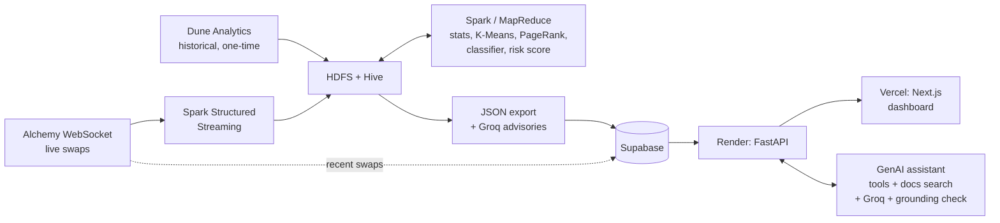

# Meridian

A DeFi stablecoin depeg & liquidity-stress early-warning **framework**,
built as a Big Data Analytics project on a local Hadoop/Hive/Spark stack,
extended with a live on-chain streaming pipeline and a public findings
dashboard. The core deliverable is a distributed data pipeline that scores
stress in real time and has been measured — not assumed — to provide real
lead time on a genuine depeg; the dashboard is a window onto that pipeline,
not the project itself.

**Live dashboard:** [meridian-bda.vercel.app](https://meridian-bda.vercel.app)

## What it does

Meridian ingests on-chain stablecoin pool data (Curve, Uniswap V2) and market
prices, then processes them through a Hadoop/Hive/Spark pipeline to compute
a multi-signal stress score (price deviation, volume/trade anomalies, a
K-Means-derived stress cluster, wallet concentration) — a rule-based scoring
framework, evaluated against real events, not a "sophisticated model" dressed
up as one. It's validated against two real historical crises: **USDC's March
2023 SVB-related depeg** (recovered) and **TerraUSD's May 2022 collapse**
(didn't). A live Alchemy WebSocket feed and a Spark Structured Streaming
consumer extend the same pipeline to score current pool activity in real
time, surfaced on the dashboard above via a small FastAPI backend and
Supabase.

## Key findings

Full writeups with numbers, methodology, and confirmed design decisions are
in [`docs/FINDINGS.md`](docs/FINDINGS.md). Highlights:

- **Measured 72-hour lead time on USDC's March 2023 depeg** — the risk
  score crossed a genuine, independently-derived elevated threshold a full
  3 days before price sustainably broke $0.99, with 12 brief false alarms
  across ~6 months of surrounding data. Tested against UST, the same
  method correctly finds **zero** lead time — not because the system
  failed, but because UST was already destabilized at the earliest data
  this project has, a real distinction the system draws rather than a
  limitation it hides.
- **UST has no reliable baseline in this dataset — and that's a finding,
  not a gap.** Its pools were already meaningfully unstable before the
  defined crisis window even starts, so no historical period can honestly
  serve as "calm" ground truth for UST.
- **Most top-ranked "influential wallets" by PageRank are infrastructure
  (routers, aggregators), not traders** — a naive influence ranking
  conflates the two.
- **Stress-pattern clustering (K-Means) separates by severity and coin,
  not just calm-vs-crisis** — four clusters emerge that track *how bad*
  and *which pair*, not a binary label.
- **A classifier trained on one coin's crisis pattern beats the rule-based
  baseline testing on the other's mild depeg, but loses badly testing on
  the severe one** — a concrete, honest result from leave-one-coin-out
  validation on two historical events, not a claim of general predictive
  power.

## Architecture

The detailed version (every component, the GenAI layer, the offline evaluation) is in
[`docs/ARCHITECTURE_DIAGRAM.md`](docs/ARCHITECTURE_DIAGRAM.md).

Historical data (Dune Analytics) and a live Alchemy WebSocket feed land in
the same Hive schema, distinguished by a `source` column. Spark/MapReduce
jobs compute statistics, clustering, PageRank, and risk scores. A batch
export materializes dashboard-ready JSON, which is pushed to Supabase and
served through a Render-hosted API — the deployed dashboard polls that API
(60s revalidate) rather than reading static files, so new pipeline output
reaches it without a rebuild. Full detail, including every confirmed design
decision and why, in [`docs/ARCHITECTURE.md`](docs/ARCHITECTURE.md).

## GenAI layer

Two uses of an LLM (Groq), both kept on a short leash because the **rule-based pipeline, not the
model, produces the risk assessment**:

- **Risk advisories** on the "Live now" cards: a 2-3 sentence plain-English reading of each
  live score, generated in the 2-hourly publish job from the row's own numbers.
- **A grounded assistant** (`/assistant`, unlisted): ask about the live scores, the two crises or the
  methods. It answers only from tools over the same tables and from the project docs, cites its sources,
  refuses advice and predictions, and every number in an answer is checked against the evidence it was
  shown.

It is measured, not just demoed (`genai/eval`, full tables and failures in
[`genai/eval/results/REPORT.md`](genai/eval/results/REPORT.md)): on a frozen 47-question test set the assistant
answered 36 correctly (77%); the grounding check caught 100 of 105 deliberately altered numbers; and an advisory
comparison across three models found no invented numbers but one model adding unrequested risk verdicts in 97 of
100 advisories. Small samples, single runs. Design, decisions and deviations:
[`docs/GENAI_ASSISTANT_PLAN.md`](docs/GENAI_ASSISTANT_PLAN.md).

## Tech stack

Hadoop 3.4.3 (HDFS/YARN/MapReduce) · Hive 3.1.3 · Spark 3.5.5 (batch +
Structured Streaming) · Sqoop 1.4.7 · MongoDB · Python (ingestion/streaming)
· Next.js 16 (dashboard, App Router) · FastAPI (live backend) · Supabase
(Postgres) · Render + Vercel (hosting) · Groq (LLM inference for advisories and the assistant)

## Repo structure

| Path | Contents |
|---|---|
| `ingestion/` | Data ingestion scripts — historical backfill and the live Alchemy WebSocket feed |
| `hive/` | Hive DDL — table schemas for the pipeline |
| `spark/` | Spark batch jobs (stats, clustering, classifier, PageRank, dashboard export) and the Structured Streaming consumer |
| `sqoop/` | Sqoop import configuration and generated artifacts |
| `dashboard/` | Next.js findings dashboard (deployed to Vercel) |
| `backend/` | FastAPI service (deployed to Render) serving dashboard data from Supabase, plus `backend/assistant/` (the grounded assistant) and its tests |
| `genai/` | Offline GenAI evaluation (`genai/eval`: frozen snapshot, questions, runners, results) and the docs-corpus builder |
| `supabase/` | Supabase schema (tables + RLS policies) for the live backend |
| `systemd/` | `systemd --user` unit files for the always-on live-feed and streaming consumer |
| `docs/` | Full documentation — see index below |
| `data/` | Local data directories (gitignored contents — regenerated/fetched, not committed) |

## Getting started

This project runs against a local Hadoop/Hive/Spark stack plus several
external services (Alchemy, Supabase, Render, Vercel). The full install log
and exact setup sequence — including the live backend provisioning steps —
are in [`docs/SETUP.md`](docs/SETUP.md). There's no single install script;
follow that doc's sections in order for the component you're setting up.

## Documentation

| Doc | Covers |
|---|---|
| [`docs/ARCHITECTURE.md`](docs/ARCHITECTURE.md) | Full system design across all layers, with confirmed decisions and why |
| [`docs/FINDINGS.md`](docs/FINDINGS.md) | Genuine analytical results from the data |
| [`docs/SETUP.md`](docs/SETUP.md) | Running install log — exact versions, configs, env vars, provisioning steps |
| [`docs/DATA_SOURCES.md`](docs/DATA_SOURCES.md) | Data source evaluation and selection |
| [`docs/SCOPE.md`](docs/SCOPE.md) | What's in scope / explicitly descoped |
| [`docs/LAB_MAPPING.md`](docs/LAB_MAPPING.md) | Course lab-requirement coverage mapping |
| [`docs/ROADMAP.md`](docs/ROADMAP.md) | Outstanding/planned work |
| [`docs/ARCHITECTURE_DIAGRAM.md`](docs/ARCHITECTURE_DIAGRAM.md) | Full architecture diagram (Mermaid) |
| [`docs/GENAI_ASSISTANT_PLAN.md`](docs/GENAI_ASSISTANT_PLAN.md) | GenAI assistant, evaluation and LLM-judge plan, with an implementation log of every deviation |
| [`genai/eval/results/REPORT.md`](genai/eval/results/REPORT.md) | Measured GenAI results, failures and limitations |
| [`docs/PRESENTATION_ONEPAGER.md`](docs/PRESENTATION_ONEPAGER.md) | One-page summary of the problem, solution and results |
| [`CLAUDE.md`](CLAUDE.md) | Project conventions and operating constraints (for AI-assisted development) |
