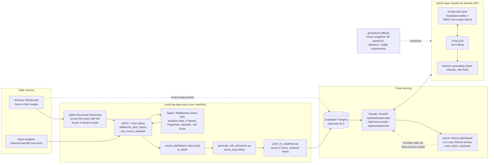

# Architecture diagram

Rendered by GitHub (Mermaid). Source of truth for what each box does is
[ARCHITECTURE.md](ARCHITECTURE.md); the GenAI layer is specified in
[GENAI_ASSISTANT_PLAN.md](GENAI_ASSISTANT_PLAN.md).

## Reading the diagram

- **Solid arrows** are data flow in the normal pipeline. **Dotted arrows** are side
  paths: the live feed publishes raw recent swaps straight to Supabase (it does not need
  Hadoop or Spark running), the browser never talks to Render directly (Next.js route
  handlers proxy it), and the evaluation harness measures the assistant offline.
- The dashboard never queries Hive live (a trivial query took 46-56 s on this stack), so
  everything it shows is exported, pushed to Supabase, and served by the Render API.
- The model never produces the risk assessment: the rule-based pipeline computes the score
  and the model only explains and retrieves, with every number in an answer checked against
  the evidence it was given.
